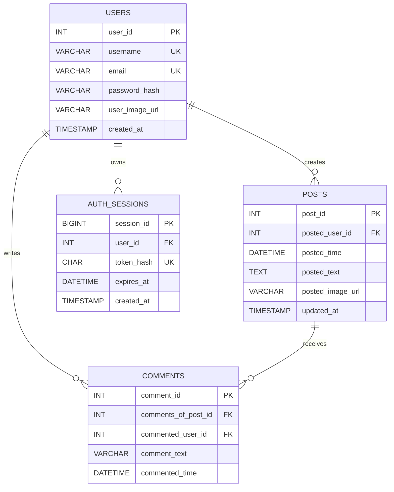

# Alur Baksho — ER diagram

## Keys, data types and cardinality

| Relationship | Cardinality | Meaning |
|---|---|---|
| `users.user_id` → `posts.posted_user_id` | One-to-many (1:M) | One user can create many posts; each post has one author. |
| `users.user_id` → `comments.commented_user_id` | One-to-many (1:M) | One user can write many comments; each comment has one author. |
| `posts.post_id` → `comments.comments_of_post_id` | One-to-many (1:M) | One post can receive many comments; each comment belongs to one post. |
| `users.user_id` → `auth_sessions.user_id` | One-to-many (1:M) | One user can have multiple active sessions/devices. |

`user_id`, `post_id`, `comment_id`, and `session_id` are primary keys. The `posted_user_id`, `commented_user_id`, `comments_of_post_id`, and `auth_sessions.user_id` columns are foreign keys. `username`, `email`, and `token_hash` have unique constraints. Posts and comments use `ON DELETE CASCADE` so child rows do not become orphaned when their parent is deleted.
